# Real-Time Air Quality Monitoring and City Ranking for India

A Big Data Analytics project that replays five years of Indian air-pollution readings as a **live data stream**, processes it in real time with **Apache Kafka** and **Apache Spark Structured Streaming**, stores the results in **Delta Lake**, and shows a continuously updating **ranking of the most polluted cities** on a web dashboard, with Mumbai as the home city.

Alongside the live pipeline, the same data is analysed in **batch** to answer longer-term questions (seasons, time of day, the 2020 COVID lockdown, Mumbai vs Delhi), the streaming results are **checked against the batch results** to prove they are correct, and a **machine-learning model** predicts a reading's air-quality category.

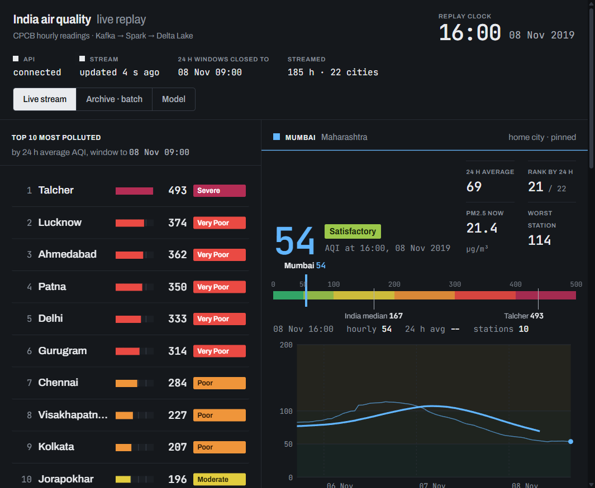

---

## Contents

1. [The problem](#1-the-problem)
2. [The data](#2-the-data)
3. [How the system works (big picture)](#3-how-the-system-works-big-picture)
4. [Each stage explained](#4-each-stage-explained)
5. [Results and findings](#5-results-and-findings)
6. [The dashboard](#6-the-dashboard)
7. [Design decisions and why](#7-design-decisions-and-why)
8. [Limitations and honest caveats](#8-limitations-and-honest-caveats)
9. [How to run it](#9-how-to-run-it)
10. [Project structure](#10-project-structure)
11. [Glossary of terms](#11-glossary-of-terms)
12. [Technology and versions](#12-technology-and-versions)

---

## 1. The problem

India has some of the most polluted cities in the world. The Central Pollution Control Board (**CPCB**) runs hundreds of monitoring stations that report pollutant levels **every hour**. That creates a continuous flow of data, and two kinds of questions:

| Kind of question | Example | Needs |
|---|---|---|
| **Right now** | "Which 10 cities have the worst air over the last 24 hours, at this moment?" "Has any station just crossed a dangerous level?" | **Stream processing**: results update within seconds as new readings arrive |
| **Over time** | "How much did the 2020 lockdown reduce pollution?" "Which months are worst?" | **Batch processing**: one pass over the complete history |

A real Big Data system usually needs both. This project builds both on the same data and then proves that they agree.

---

## 2. The data

**Source:** [Air Quality Data in India (2015–2020)](https://www.kaggle.com/datasets/rohanrao/air-quality-data-in-india) on Kaggle, compiled from CPCB's public portal.

Two files are used:

| File | What it contains | Size |
|---|---|---|
| `station_hour.csv` | One row per station per hour: 12 pollutant readings, the AQI, and the AQI category | 2,589,083 rows |
| `stations.csv` | Each station's name, city and state | 230 stations |

**Pollutants measured:** PM2.5, PM10, NO, NO2, NOx, NH3, CO, SO2, O3, Benzene, Toluene, Xylene.

### What is AQI?

The **Air Quality Index (AQI)** turns many pollutant readings into a single number from 0 upwards, so that people can understand air quality at a glance. India's official scale (CPCB) is:

| AQI | Category | Health meaning |
|---|---|---|
| 0–50 | **Good** | Minimal impact |
| 51–100 | **Satisfactory** | Minor breathing discomfort for sensitive people |
| 101–200 | **Moderate** | Discomfort for people with lung or heart disease, children, older adults |
| 201–300 | **Poor** | Breathing discomfort for most people on long exposure |
| 301–400 | **Very Poor** | Respiratory illness on long exposure |
| 401+ | **Severe** | Affects healthy people; serious for those with existing disease |

The dashboard and charts use these same six colours and thresholds everywhere.

### Cleaning the data

Raw sensor data is messy, so a one-time Spark job prepares it:

1. **Attach a city to every reading.** Station readings only carry a station ID, so they are joined with `stations.csv` to get the city and state.
2. **Drop readings with no AQI.** AQI is what the project ranks and predicts; a reading without it is useless here.
3. **Fill missing pollutant values sensibly.** Sensors often fail for a few hours, and some pollutants (Xylene, for example) are missing in over a million rows. Instead of throwing those rows away, a gap is filled with **that city's average for that month and year**. If the whole city has no reading of that pollutant in that month, the **all-India average for that month** is used. This keeps seasonal patterns intact, because a missing January value is filled with a January average, not a yearly one.
4. **Sort by time** and save one clean CSV for the stream replay, plus a Parquet copy for fast batch analysis.

**Result:** 2,018,893 clean hourly readings from **26 cities**, January 2015 to July 2020.

---

## 3. How the system works (big picture)

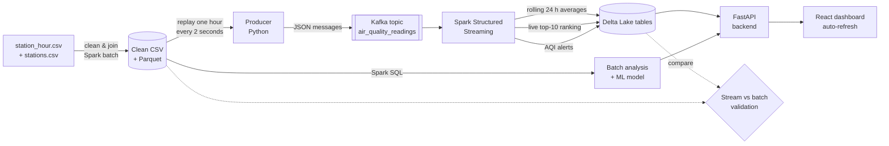

### The journey of one reading

Follow a single reading, say *Bandra, Mumbai, 1 Nov 2019, 14:00, PM2.5 = 48, AQI = 112*:

1. **Producer:** reads it from the clean CSV along with every other reading for 14:00, and publishes each one as a small JSON message to Kafka.
2. **Kafka:** stores the message durably in the topic `air_quality_readings`. The message key is the city, so all Mumbai readings stay in order together.
3. **Spark Streaming:** picks up new messages every few seconds (a *micro-batch*) and:
   - adds the reading to Mumbai's **hourly** average for 14:00–15:00;
   - adds it to **24 overlapping 24-hour windows** (the ones ending at 15:00, 16:00, … up to 14:00 the next day), each of which is one point on Mumbai's rolling average line;
   - checks it against the **alert rule** (AQI > 300). At 112 it passes quietly.
4. **Delta Lake:** once a window is complete, Spark writes the result as a new, versioned table commit and rebuilds the **top-10 ranking**.
5. **API + dashboard:** the browser asks the API for fresh data every few seconds; the API reads the newest Delta version, and the dashboard redraws the rankings, the Mumbai panel and the alert log.

---

## 4. Each stage explained

### 4.1 Kafka: the message buffer

**Apache Kafka** sits between the data source and the processing. It is a durable, ordered log of messages: the producer appends to the end, and Spark reads from wherever it last stopped.

Why it is needed:

- **Decoupling:** the producer does not need to know whether Spark is running, slow, or restarting. Messages wait safely in Kafka.
- **Replay:** because Kafka keeps messages, a crashed Spark job resumes exactly where it stopped, with no lost readings.
- **Scale:** the topic is split into **3 partitions**, so in a bigger deployment several consumers could share the load.

Kafka runs in **KRaft mode**, its modern setup in which Kafka manages its own cluster metadata without the separate ZooKeeper service older versions needed.

### 4.2 The producer: turning history into a live stream

The dataset is historical, so a small Python program **simulates real time**. It reads the clean CSV in time order and sends **all readings for one hour, then waits** (2 seconds by default) before sending the next hour. One simulated day therefore takes about 48 seconds, which makes a day's pollution cycle visible during a short demo. The speed and the start date (for example, winter 2019, when pollution is dramatic) are adjustable.

### 4.3 Spark Structured Streaming: the real-time brain

**Spark Structured Streaming** treats the Kafka stream as a table that keeps growing, and runs the same kind of query you would write on a normal table, just continuously. It works in **micro-batches**: every few seconds it takes whatever new messages arrived and updates the results.

Three continuous queries run side by side:

| Output | What it computes | Why |
|---|---|---|
| **(a) Rolling 24-hour average per city** | Average PM2.5 and AQI per city over the last 24 hours, recomputed every hour | CPCB's AQI is defined on 24-hour averages; a single hour is too noisy to rank cities fairly |
| **(b) Live top-10 ranking** | The 10 cities with the highest 24-hour average AQI in the newest finished window | The headline "which cities are worst right now" |
| **(c) AQI alerts** | Every station reading with AQI above 300 (Very Poor or Severe) | Immediate warning; no averaging, just a filter, so alerts appear with no extra delay |

A fourth helper output keeps the **latest hourly average per city** for the dashboard's "right now" numbers.

#### Event time vs processing time

Every reading carries the time it was **measured** (*event time*). That can differ from the time Spark **receives** it (*processing time*), because networks lag and stations upload late. All windows here use **event time**, so a reading measured at 14:00 always counts toward the 14:00 hour, even if it arrives at 14:40.

#### Sliding windows

A **24-hour window that slides every hour** means: at 14:00 the window covers yesterday 14:00 to today 14:00; at 15:00 it covers yesterday 15:00 to today 15:00, and so on. Each reading belongs to 24 such overlapping windows. This produces a smooth rolling-average line rather than one number per day.

#### Watermark: how long to wait for late data

Spark cannot keep every window open forever waiting for stragglers; memory would grow without limit. A **watermark of 2 hours** sets the rule: *"once I have seen a reading timestamped 16:00, I assume nothing older than 14:00 is still coming."* At that point, any window ending at or before 14:00 is **final**. Spark writes it once and frees its memory. Readings that arrive more than 2 hours late are ignored. This is the standard trade-off between **completeness** (waiting longer) and **freshness and memory** (waiting less).

#### Checkpoints: surviving crashes

Each query saves its progress (which Kafka messages it has read, plus the partial window sums) to a **checkpoint** folder. If Spark stops or crashes, it restarts from the checkpoint and continues as if nothing happened, without double-counting or losing readings.

### 4.4 Delta Lake: reliable storage

Results are written to **Delta Lake** tables: Parquet files plus a **transaction log** that records every change as a numbered version.

This matters because the dashboard reads the tables **while Spark is writing to them**:

- **ACID transactions:** a reader always sees a complete version, never a half-written file. The top-10 table is replaced in one atomic step, so the dashboard never shows 7 cities, or 13.
- **Exactly-once writes:** each micro-batch write is tagged with its batch number. If Spark retries a batch after a failure, Delta recognises the tag and skips the duplicate.
- **Versioning (time travel):** every update is a new version, so the history of the ranking is recoverable.

If Delta Lake were unavailable, plain Parquet would work as a fallback, but without these guarantees.

### 4.5 API and dashboard

A small **FastAPI** server reads the Delta tables directly (through the lightweight `deltalake` library, with no Spark needed) and serves them as JSON. It re-reads a table only when its Delta version number changes. The **React** dashboard polls the API every few seconds and redraws itself. See [section 6](#6-the-dashboard).

### 4.6 Batch analysis

The full clean dataset is analysed with **Spark SQL** in one pass:

- average PM2.5 by **month** (seasons) and by **hour of day** (daily cycle);
- the **2020 lockdown**: 25 March to 30 June 2020 compared with the same dates in 2019, using **only cities that have data in both years**, so the comparison is like-for-like;
- **Mumbai vs Delhi** month by month;
- a long-run ranking of all cities.

### 4.7 Validating the stream against batch

Streaming code is harder to get right than batch code: late data, windows, watermarks and restarts all add risk. To prove the live numbers are correct, a validation job:

1. reads every 24-hour window the stream produced;
2. recomputes **the same windows** in batch from the original clean data, over exactly the period the stream covered;
3. compares them window by window: Is any window missing? Duplicated? Does each window contain the same number of readings? Do the averages match?

The check **passes** only if nothing is missing or duplicated, every reading count matches, and every average agrees to within rounding.

### 4.8 Machine-learning model (optional extension)

A **Random Forest** classifier predicts a reading's **AQI category** (Good to Severe) from its pollutant values, the hour, the month and the city.

- **Time-based split:** trained on 2015–2019 and tested on 2020. This mimics real use (predicting the future from the past) and is a stricter test than a random split, because 2020 includes the unusual lockdown months.
- **Evaluation:** accuracy, **F1 score** per category and overall, a **confusion matrix**, and **feature importance** (which inputs the model relied on most).

---

## 5. Results and findings

All charts are generated into `reports/figures/`.

### Pollution follows the seasons

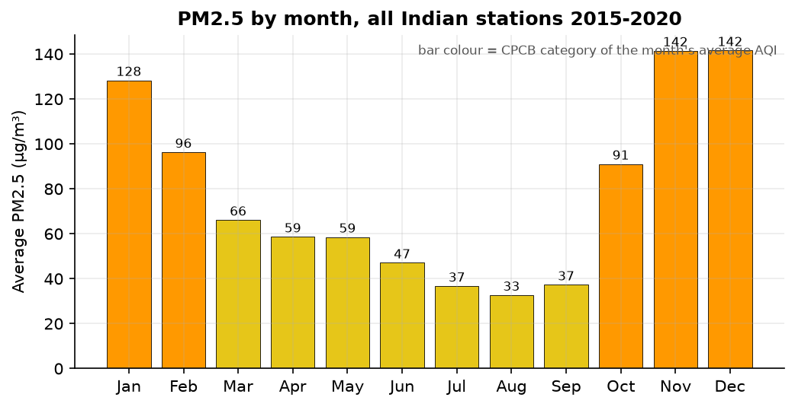

Average PM2.5 in **November–December (~141 µg/m³)** is **over four times** the August level (~33 µg/m³). Winter combines crop-residue burning in the north, festival fireworks, low wind and *temperature inversions* that trap pollution near the ground. The monsoon (July–September) washes particles out of the air.

### Pollution peaks at night

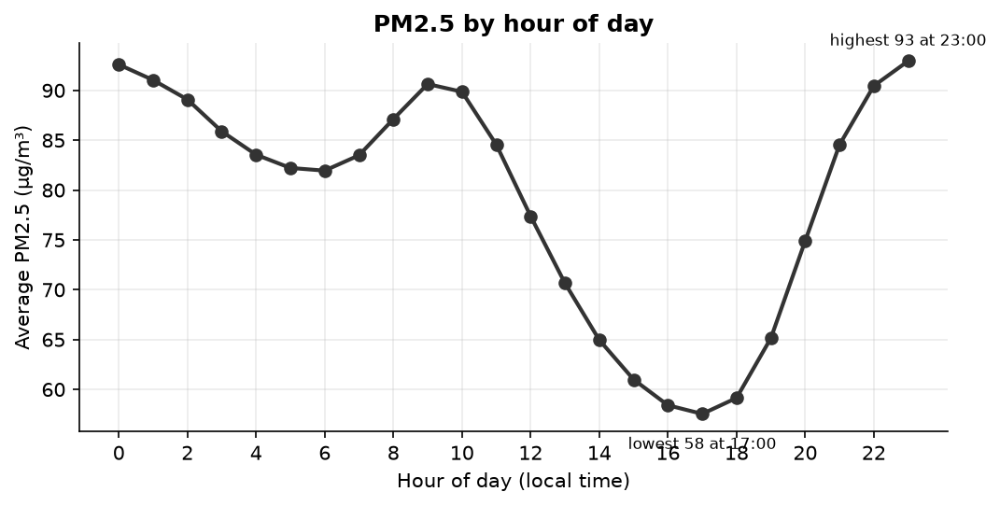

PM2.5 is highest around **11 pm–midnight (~93)** and lowest around **5 pm (~58)**. In the afternoon the sun heats the ground and pollution mixes upward into a deep layer of air; at night that layer becomes shallow and pollutants concentrate near the surface. A smaller morning rise lines up with traffic.

### The 2020 lockdown cleaned the air

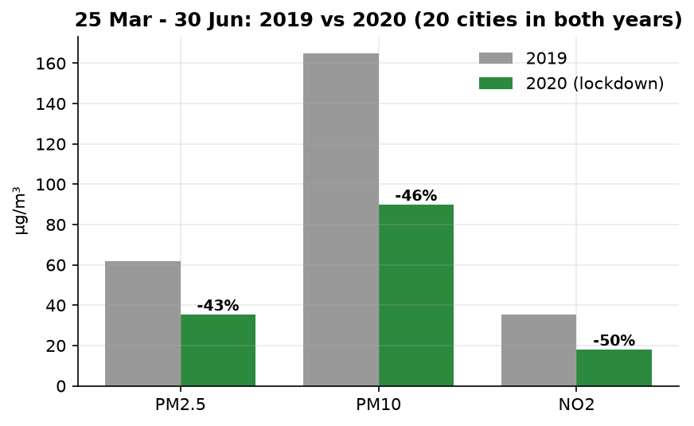

Across the **20 cities** with data in both years, comparing 25 March to 30 June:

| Pollutant | 2019 | 2020 | Change |
|---|---|---|---|
| PM2.5 (µg/m³) | 61.8 | 35.3 | **−42.9%** |
| PM10 (µg/m³) | 165.1 | 89.8 | **−45.6%** |
| NO2 (µg/m³) | 35.6 | 17.9 | **−49.6%** |
| Average AQI | 168.8 | 97.9 | **−42.0%** |

NO2, which comes mostly from vehicles and industry, fell the most, which fits traffic and factories stopping.

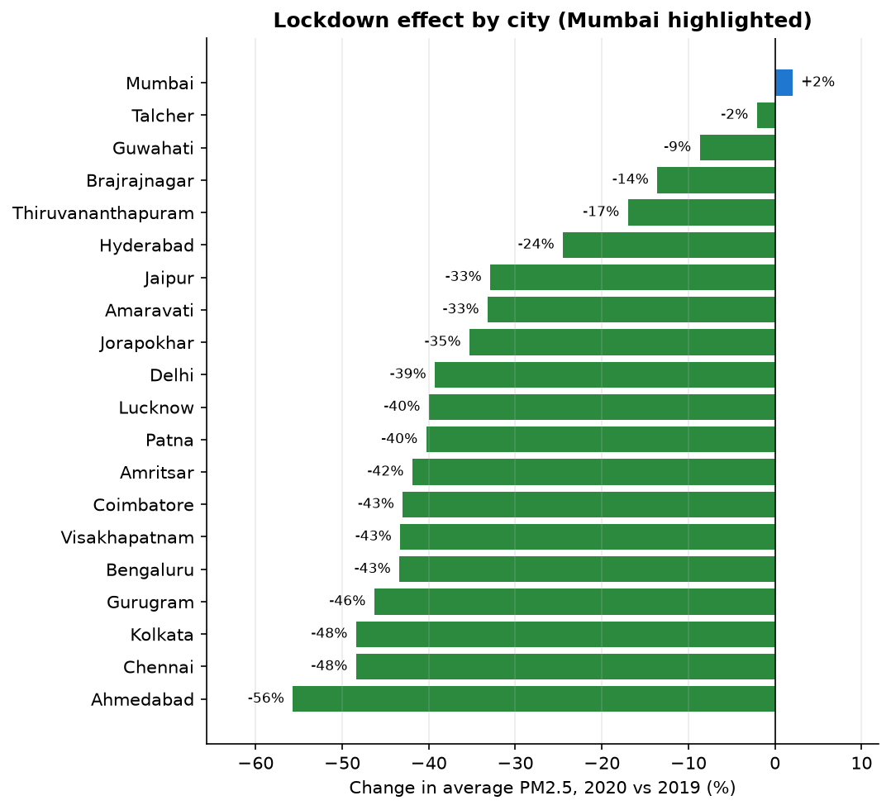

**Mumbai is the interesting exception:** its PM2.5 barely moved (+2%), while its **NO2 dropped 37%**. Mumbai's pre-monsoon PM2.5 was already low in 2019 (~16 µg/m³, among the cleanest in the comparison), because sea breezes clear its air, so there was little particulate pollution left to remove. The traffic signal (NO2) still fell sharply.

### Mumbai vs Delhi

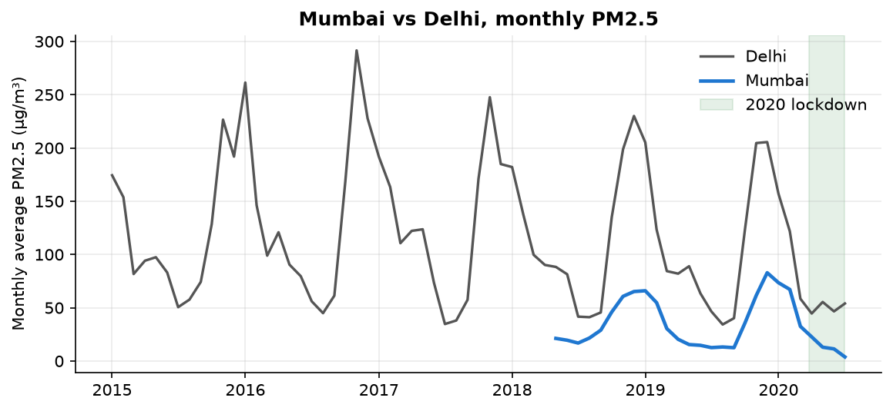

Delhi's long-run average PM2.5 is **110 µg/m³**, three times Mumbai's **37**. Delhi's winter peaks reach 200–290 every year; Mumbai's coastal location keeps its peaks under ~85. Both cities follow the same seasonal rhythm.

### The live stream matches batch exactly

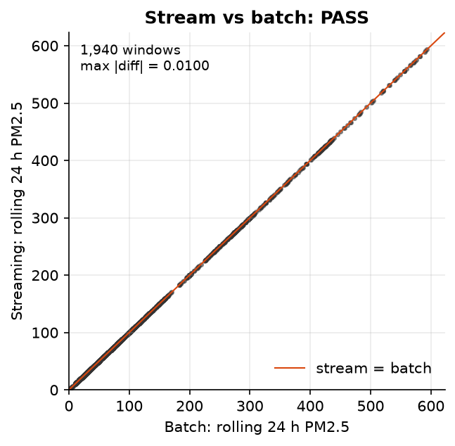

| Check | Result |
|---|---|
| 24-hour windows compared | 1,940 (1,459 of them full 24-hour windows) |
| Windows missing on the batch side | 0 |
| Duplicate windows from the stream | 0 |
| Windows with a different reading count | 0 |
| Largest difference in average PM2.5 | 0.01 (the last rounded decimal) |
| **Verdict** | **PASS** |

Every point lies on the "stream = batch" line. The only differences are in the second decimal place, where the two engines add numbers in a different order before rounding.

### The live ranking

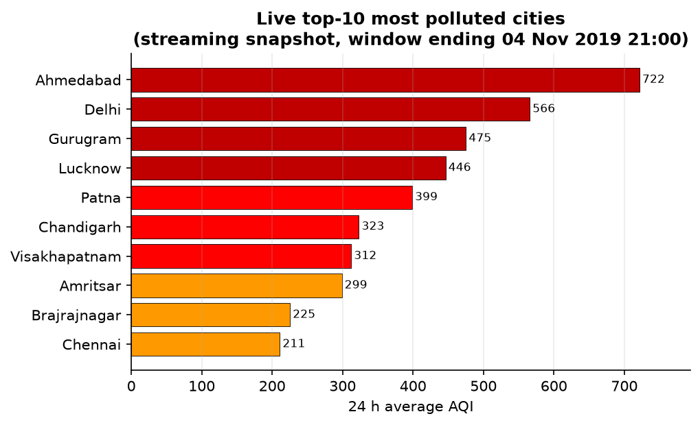

A snapshot of the streaming top-10 in early November 2019, when northern India's winter smog season is at its worst.

### Machine-learning model

| Metric | Value |
|---|---|
| Training rows (2015–2019, 30% sample) | 480,761 |
| Test rows (2020) | 125,577 |
| Accuracy | **61.3%** |
| Weighted F1 score | **0.581** |

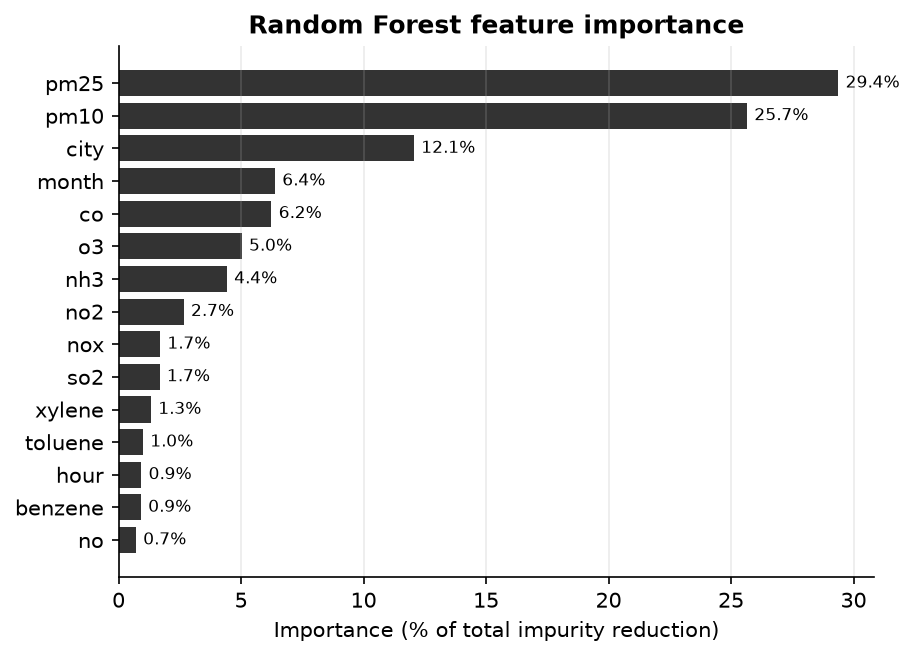

**PM2.5 (29%)** and **PM10 (26%)** dominate, followed by **city (12%)**. That matches how the AQI works in India: particulate matter is usually the pollutant that decides a city's AQI.

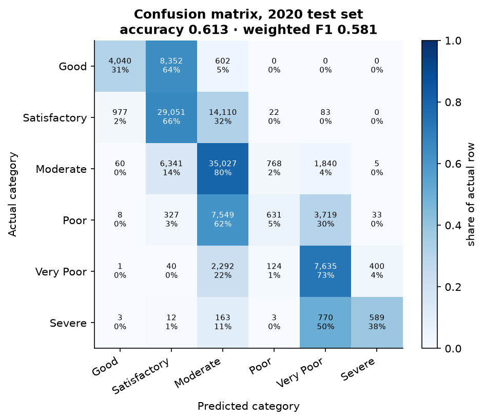

**How to read this:** most mistakes land in a **neighbouring** category (for example, Good predicted as Satisfactory), almost never two or more categories away. The weakest class is **Poor** (F1 0.09): it is a narrow band squeezed between Moderate and Very Poor, so the model tends to push those readings to either side.

**Why ~61% is expected, not a failure:** the AQI category in the dataset is computed from **24-hour averages** of pollutants, but the model sees **only one hour** of readings. It is guessing a day-long label from a one-hour snapshot. On top of that, the test year 2020 was unusual because of the lockdown. Adding the previous 24 hours of readings as features would be the natural next improvement.

---

## 6. The dashboard

A custom-built React web app styled as a **dark "control-room" console**, designed for presenting on a projector. It refreshes itself automatically; nothing needs to be clicked during a demo.

**Status rail (top):**

- the **replay clock**, which shows the simulated date and time the stream has reached;
- pipeline lamps for the API and for the stream (the stream lamp turns idle if no new data has arrived for 45 seconds);
- how far the 24-hour windows have been finalised, and how many hours have been streamed.

**Live stream tab:**

- **Top 10 most polluted:** cities ranked by 24-hour average AQI, with colour bars on the 0–500 CPCB scale. Rows slide smoothly when cities swap places.
- **Focus panel (Mumbai by default):** Mumbai's current AQI, its category, its rank among all cities, the worst station, a colour rail comparing Mumbai with the India median and the worst city, and a chart of the last 72 hours (thin line: hourly; thick line: rolling 24-hour average). Click any city to focus it instead.
- **Alert log:** every reading above AQI 300, newest first, in a terminal-style log.
- **Every city, latest hour:** a sortable table of all cities with a 24-cell strip showing each city's category for each of the last 24 hours.

**Archive · batch tab:** the validation verdict, lockdown comparison, seasonal and daily charts, Mumbai vs Delhi, and the long-run city ranking.

**Model tab:** the ML metrics, per-category F1, feature importance and the confusion matrix.

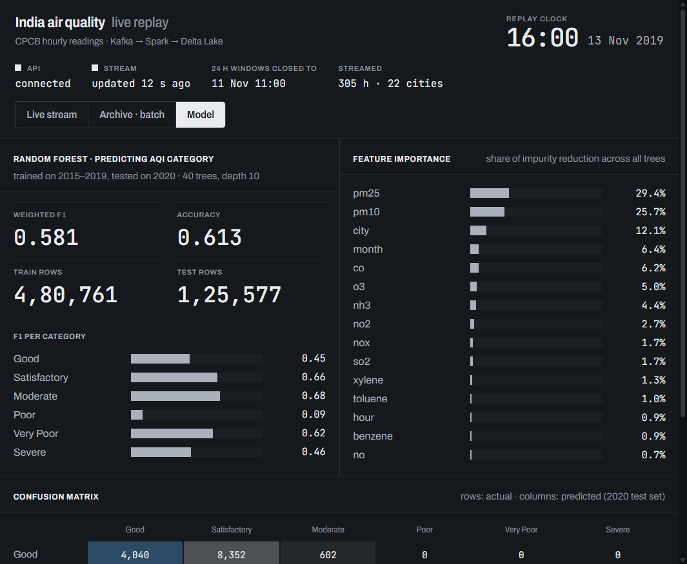

The layout adapts to laptops and phones:

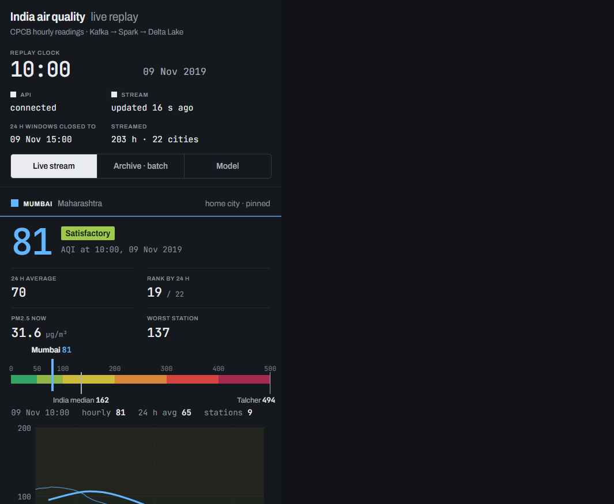

---

## 7. Design decisions and why

| Decision | Reason |
|---|---|
| **Replay historical data instead of a live API** | CPCB's live API is rate-limited and unreliable. Replaying real historical data gives a repeatable demo, and the speed can be controlled. |
| **Rank on 24-hour averages, not single hours** | CPCB defines AQI on 24-hour averages; single hours swing wildly with one sensor's noise. |
| **Event time + watermark** | Results depend on when pollution happened, not when the message happened to arrive. |
| **2-hour watermark** | Long enough to tolerate realistic upload delays, short enough that the ranking stays fresh and memory stays bounded. |
| **Alerts are stateless** | A dangerous reading should appear immediately, not after a window closes. |
| **Delta Lake over plain files** | The dashboard reads while Spark writes; Delta guarantees it never sees a half-written result, and prevents duplicates on retry. |
| **Fill gaps with city + month averages** | Keeps over 2 million rows that would otherwise be lost, without blurring seasonal patterns. |
| **Kafka message key = city** | All of a city's readings land in the same partition, which keeps them in order. |
| **Validate stream vs batch** | Turns "it seems to work" into a measurable proof of correctness. |
| **Time-based ML split** | A random split would leak future information into training and overstate accuracy. |
| **Spark runs in Docker** | Avoids installing Java, Hadoop and Spark on Windows; the same setup runs on any machine. |

---

## 8. Limitations and honest caveats

- **Single machine, single broker.** Kafka runs as one broker with no replication, and Spark runs in local mode. This shows the architecture but not fault tolerance across machines. In production you would use 3+ Kafka brokers and a Spark cluster.
- **Simulated real time.** The data ends in July 2020; "live" means a faithful replay, not today's air.
- **The AQI is pre-computed in the dataset.** It already reflects 24-hour averaging, so even the "hourly" line on the dashboard looks smooth.
- **Ahmedabad's AQI looks anomalous.** It has the highest long-run AQI (453) from a single station, yet only moderate PM2.5 (67). This most likely reflects a sensor or calculation problem in the source data, so its top ranking should be treated with caution.
- **Update latency of about 10 seconds.** On a laptop each micro-batch takes roughly 8–15 seconds, so the dashboard moves forward a few simulated hours at a time.
- **The ranking trails the clock slightly.** A 24-hour window is only final once the watermark passes it (2 simulated hours), and the three streaming queries run independently, so the top-10 is usually a few simulated hours behind the replay clock.
- **Timestamps are Indian local time.** CPCB timestamps carry no time zone; they are kept as-is (Spark is set to UTC only so it never shifts them).
- **The ML model sees one hour at a time,** which caps its accuracy (see [section 5](#machine-learning-model)).

---

## 9. How to run it

### What you need

- **Docker Desktop** (runs Kafka and Spark)
- **Python 3.10+** (runs the producer, the API and the charts)
- **Node.js 20+** (runs the dashboard)
- The two Kaggle files `station_hour.csv` and `stations.csv` placed in `data/raw/` (Kaggle requires a login, so this step is manual)

### First-time setup

```powershell
docker compose up -d --build                      # start Kafka + build the Spark image
python -m venv .venv
.venv\Scripts\pip install -r requirements.txt     # producer, API, charts
cd dashboard; npm install; cd ..                  # dashboard
```

### Prepare data and run the batch analysis (once)

```powershell
.\scripts\spark-submit.ps1 spark_jobs/prepare_data.py     # clean CSV + Parquet into data/processed/
.\scripts\spark-submit.ps1 spark_jobs/batch_analysis.py   # results into output/batch/
```

### Run the live demo (four terminals)

```powershell
.\scripts\reset_stream.ps1                                       # clean slate + (re)create Kafka topic

# Terminal 1: Spark streaming job (leave running)
.\scripts\spark-submit.ps1 spark_jobs/streaming_job.py

# Terminal 2: replay producer (one simulated hour every 2 s, from 1 Nov 2019)
.venv\Scripts\python.exe producer\producer.py --speed 2 --start 2019-11-01

# Terminal 3: API
.venv\Scripts\uvicorn api.server:app --host 127.0.0.1 --port 8077

# Terminal 4: dashboard, then open http://localhost:5173
cd dashboard; npm run dev
```

### After a few simulated days have streamed

```powershell
.\scripts\spark-submit.ps1 spark_jobs/validate_stream_vs_batch.py    # prints PASS / FAIL

# Stop the streaming job first (Ctrl+C) to free memory, then:
$env:SPARK_DRIVER_MEMORY = "3g"
.\scripts\spark-submit.ps1 spark_jobs/train_model.py                 # results into output/ml/

.venv\Scripts\python.exe reports\make_charts.py                      # PNGs into reports/figures/
```

### Useful Kafka commands

```powershell
# list topics
docker compose exec kafka /opt/kafka/bin/kafka-topics.sh --bootstrap-server localhost:9092 --list
# describe the topic (partitions, leader)
docker compose exec kafka /opt/kafka/bin/kafka-topics.sh --bootstrap-server localhost:9092 --describe --topic air_quality_readings
# peek at 5 live messages
docker compose exec kafka /opt/kafka/bin/kafka-console-consumer.sh --bootstrap-server localhost:9092 --topic air_quality_readings --max-messages 5
```

### Notes

- `scripts/spark-submit.ps1` wraps the full command. For reference, it runs:
  ```
  docker compose exec spark spark-submit --master local[*] --driver-memory 2g \
    --packages org.apache.spark:spark-sql-kafka-0-10_2.12:3.5.9,io.delta:delta-spark_2.12:3.3.2 \
    --conf spark.sql.extensions=io.delta.sql.DeltaSparkSessionExtension \
    --conf spark.sql.catalog.spark_catalog=org.apache.spark.sql.delta.catalog.DeltaCatalog \
    /app/spark_jobs/<job>.py
  ```
- On macOS or Linux, use the `.sh` versions of the scripts, and `.venv/bin/python` instead of `.venv\Scripts\python.exe`.
- The API uses port **8077** on `127.0.0.1` to avoid clashing with other local servers on port 8000.
- Spark's live job monitor is at http://localhost:4040 while a job runs.

---

## 10. Project structure

```
├── data/
│   ├── raw/                  Kaggle files (you add these)
│   └── processed/            clean CSV + Parquet (generated)
├── docker-compose.yml        Kafka (KRaft) + Spark containers
├── spark/                    Spark image definition + log settings
├── producer/producer.py      replays the CSV into Kafka, hour by hour
├── spark_jobs/
│   ├── common.py             shared paths, schema, Spark session setup
│   ├── prepare_data.py       cleaning and joining
│   ├── streaming_job.py      rolling averages, top-10, alerts → Delta
│   ├── batch_analysis.py     Spark SQL analyses
│   ├── validate_stream_vs_batch.py
│   └── train_model.py        Random Forest on AQI category
├── api/server.py             FastAPI: Delta tables → JSON
├── dashboard/                React + Vite web app
├── reports/
│   ├── make_charts.py        Matplotlib figures for the report
│   └── figures/              generated PNGs
├── scripts/                  spark-submit wrapper, demo reset (PowerShell + bash)
└── output/                   Delta tables, batch CSVs, ML results (generated)
```

---

## 11. Glossary of terms

| Term | Plain-English meaning |
|---|---|
| **AQI (Air Quality Index)** | A single number summarising how polluted the air is; higher is worse. India's scale runs from Good (0–50) to Severe (401+). |
| **CPCB** | Central Pollution Control Board, the Indian government body that runs the monitoring stations and defines the AQI. |
| **PM2.5 / PM10** | Particles smaller than 2.5 / 10 micrometres. PM2.5 is fine enough to enter the lungs and bloodstream and is the most harmful common pollutant. Measured in µg/m³ (micrograms per cubic metre of air). |
| **NO2, SO2, CO, O3** | Nitrogen dioxide (mostly from vehicles), sulphur dioxide (from burning coal), carbon monoxide, and ozone. |
| **Big Data** | Data too large or too fast for one ordinary program to handle comfortably, needing distributed tools. |
| **Batch processing** | Processing a complete, fixed dataset in one go ("analyse all of 2015–2020"). |
| **Stream processing** | Processing data continuously as it arrives ("update the ranking every few seconds"). |
| **Apache Kafka** | A system that stores streams of messages durably and in order, so producers and consumers can work independently. |
| **Topic** | A named stream inside Kafka, like a channel. Here: `air_quality_readings`. |
| **Partition** | A slice of a topic. Partitions let several consumers read in parallel; order is guaranteed within a partition. |
| **Broker** | One Kafka server. Production systems run several for safety. |
| **Producer / Consumer** | A program that writes messages into Kafka / one that reads them out (here, Spark). |
| **KRaft** | Kafka's built-in way of managing its own cluster, replacing the older separate ZooKeeper service. |
| **Apache Spark** | An engine for processing large data in parallel, for both batch and streaming. |
| **Spark Structured Streaming** | Spark's streaming engine: you write queries as if on a table, and Spark keeps them updated as data flows in. |
| **Micro-batch** | Spark Streaming's unit of work: every few seconds it processes whatever new data has arrived as one small batch. |
| **Spark SQL** | Writing Spark computations in SQL, the standard database query language. |
| **Event time** | When a reading was *measured* (as opposed to when it was received). |
| **Processing time** | When the system *received or processed* a reading. |
| **Window** | A time range that readings are grouped into, for example "14:00–15:00". |
| **Tumbling window** | Back-to-back windows that don't overlap (each hour once). |
| **Sliding window** | Overlapping windows, for example "the last 24 hours", recalculated every hour. |
| **Watermark** | A rule for how long to wait for late data. Older windows are finalised and their memory freed. |
| **Late data** | Readings that arrive after other readings with later timestamps, for example because of network delays. |
| **State** | What Spark remembers between micro-batches, such as the running sums for open windows. |
| **Checkpoint** | A saved snapshot of a streaming job's progress and state, so it can resume after a crash. |
| **Append mode** | A streaming output mode where each result is written once, when final, and never changed. |
| **Exactly-once** | The guarantee that every reading affects the result once, never lost and never double-counted, even after failures. |
| **Delta Lake** | A storage layer on top of Parquet files that adds transactions, versioning and safe concurrent reads and writes. |
| **ACID** | Atomicity, Consistency, Isolation, Durability: the guarantees that make a write all-or-nothing and safe to read during updates. |
| **Parquet** | A compressed, column-oriented file format that is fast for analytics. |
| **Time travel** | Reading an older version of a Delta table. |
| **Idempotent** | Safe to repeat: doing it twice has the same effect as doing it once. |
| **Docker / Docker Compose** | Docker packages software with everything it needs into a *container*; Compose starts several containers together from one file. |
| **FastAPI** | A Python framework for building web APIs. |
| **API** | Application Programming Interface: here, web addresses the dashboard calls to fetch data as JSON. |
| **JSON** | A simple text format for structured data, readable by both humans and programs. |
| **React / Vite** | React is a JavaScript library for building interactive web interfaces; Vite is the tool that serves and builds it. |
| **Polling / auto-refresh** | The dashboard asking the API for new data at a regular interval. |
| **Random Forest** | A machine-learning model that combines many decision trees, each voting on the answer. |
| **Feature / Feature importance** | An input to the model (for example PM2.5) / how much the model relied on each input. |
| **Accuracy** | The share of predictions that were correct. |
| **Precision / Recall** | Of the readings predicted as a category, how many really were (precision); of the readings really in a category, how many were found (recall). |
| **F1 score** | A single score combining precision and recall (their harmonic mean); 1.0 is perfect. "Weighted" F1 averages the categories by their size. |
| **Confusion matrix** | A table of actual vs predicted categories, showing which categories get mistaken for which. |
| **Train/test split (time-based)** | Learning from older data and testing on newer data the model never saw. |
| **Temperature inversion** | A weather condition in which a warm air layer traps cooler, polluted air near the ground, common on winter nights. |

---

## 12. Technology and versions

| Component | Version | Role |
|---|---|---|
| Apache Kafka | 3.9.2 (KRaft mode) | Message stream |
| Apache Spark | 3.5.9 (Scala 2.12, Java 17, Python 3) | Streaming, batch and ML |
| Spark–Kafka connector | `spark-sql-kafka-0-10_2.12:3.5.9` | Lets Spark read Kafka |
| Delta Lake | `delta-spark_2.12:3.3.2` | Transactional storage |
| confluent-kafka (Python) | 2.x | Producer client |
| deltalake (Python) | 1.x | API reads Delta without Spark |
| FastAPI + Uvicorn | latest | Backend API |
| React + Vite | 19 / 8 | Dashboard |
| Matplotlib, pandas | latest | Report charts |
| Docker Compose | — | Runs Kafka and Spark |

**Dataset credit:** Vopani (Rohan Rao), *Air Quality Data in India (2015–2020)*, Kaggle, from CPCB public data.
